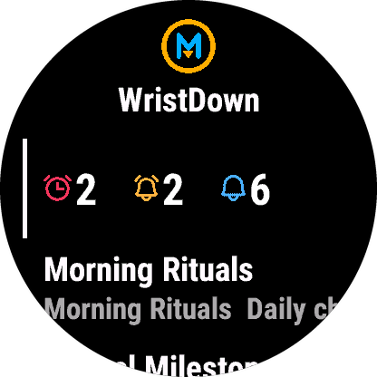

# WristDown

**Markdown notes, tasks, and reminders on your Garmin watch.** WristDown 2.0 syncs straight from a GitHub repository, so you can keep notes on your watch without running a server for them.

<!-- Connect IQ Store Badge - Update URL after publishing -->
[](https://apps.garmin.com/en-US/apps/7d7054d3-0907-4f3a-a39b-c135830bd6ba)

## Screenshots

<p>



</p>

## Ways to use it

### Notes from GitHub, no server

Point WristDown at any GitHub repository, branch, and folder. It pulls the Markdown files, processes them, and stores them on the watch, so reading works offline. Keep the watch folder small: around 10 notes works well, past 15 things get unreliable.

The setup:

1. Put `.md` notes in a GitHub repository.
2. Create a GitHub token with repository contents access.
3. In Garmin Connect, enter the repository as `owner/repo`, plus folder and branch if needed.
4. Open WristDown and hit **Sync**.

See the [GitHub setup guide](docs/github.md) for details. See the [settings guide](docs/settings.md) for watch options, Auto-Refresh, and working offline.

### Obsidian tasks

With GitHub as the source, WristDown understands a subset of the [Obsidian](https://obsidian.md/) Tasks checkbox format: tasks with a `📅` due date, plus recurrence and completion markers. I tested it with a vault synced through Git using the [Obsidian Git](https://community.obsidian.md/plugins/obsidian-git) and [Tasks](https://community.obsidian.md/plugins/obsidian-tasks-plugin) community plugins.

```markdown
- [ ] Water plants 🔁 every day 📅 2026-06-04
- [ ] Review release notes 📅 2026-06-05
- [x] Send invoice 📅 2026-06-01 ✅ 2026-06-01
```

On the watch, the emoji metadata is stripped from the note text, the tasks show up in the reminders view, and changes you make on the watch can sync back to the Markdown file.

It's not the whole Tasks plugin, though. IDs, created dates, priorities, dependencies, query blocks, and the Dataview format aren't supported. The [Markdown reference](docs/markdown.md) lists exactly what is, including recurrence forms and event tags.

> Note: when the Tasks plugin completes a recurring task, it keeps the completed line and adds a fresh one. WristDown keeps a single active line per recurring task and rewrites it in place, so the completed history is not preserved.

### Self-hosted Flatnotes

If you already run a [Flatnotes](https://github.com/dullage/flatnotes) server, that still works; it was the original sync source. It syncs your notes, and checkbox sync-back works too if you add a small reverse-proxy rewrite. See the [Flatnotes setup guide](docs/flatnotes.md).

### Quick Notes

If you just want a couple of notes with zero setup, type up to 3 notes directly into the Garmin Connect settings. No GitHub or Flatnotes needed; they show up at the top of the note list on the watch.

## What's new in 2.0

- **GitHub as a note source** - sync directly from GitHub, no self-hosting needed.
- **Obsidian-style tasks** - due dates, completion markers, and recurring rules parsed from your Markdown.
- **Reminders view** - overdue, due, and upcoming tasks and events from your GitHub notes, in one place.
- **Reminder notifications** - optional Garmin notifications when a reminder comes due.
- **GitHub sync-back** - checkbox and task changes are written back to GitHub, with SHA-based conflict protection.
- **Frontmatter preservation** - your note frontmatter survives sync-back untouched.

> The new timed tasks and event reminders work only with GitHub as the sync source; Flatnotes and Quick Notes are not supported for them. The reminders view, notifications, and glance summary also need a watch with enough memory; see [Reminders on older watches](#reminders-on-older-watches).

Full details in the [WristDown 2.0 changelog](docs/changelog-v2.0.md).

## Features by source

| Feature | GitHub | Flatnotes | Quick Notes |
|---|---|---|---|
| No self-hosted server required | Yes | No | Yes |
| Sync a note library | Yes, `.md` and `.txt` files | Yes | No, up to 3 manual notes |
| Folder or branch selection | Yes | No | n/a |
| Markdown display | Yes | Yes | Yes |
| Interactive checkboxes | Yes | Yes | On-watch only |
| Checkbox sync-back | Yes, with conflict checks | Checkbox-only, needs a PUT-to-PATCH proxy rewrite | No |
| Obsidian Tasks emoji markers | Yes | No | No |
| Recurring task write-back | Yes | No | No |
| Reminders list | Yes | No | No |
| Reminder notifications | Yes | No | No |
| Server freshness/conflict protection | Yes, SHA based | No | n/a |
| YAML frontmatter preservation | Yes | n/a | n/a |
| Demo mode | No | Yes | n/a |

> Some older watches don't get every reminder feature because of memory limits; see [Reminders on older watches](#reminders-on-older-watches).

## Supported devices

Works on 50+ Garmin watches including:

- Fenix 6/7/8 series
- Epix (Gen 2) / Epix Pro
- Forerunner 165/255/265/955/965/970
- Venu series
- ...and more

Requires API Level 3.4.0+ and a phone with Garmin Connect.

### Reminders on older watches

A few older watches don't have enough memory for the full reminder system, so they get a reduced build. Rather than drop them, I kept everything that fits: note reading, GitHub and Flatnotes sync, Quick Notes, Markdown display, checkboxes, and the task/reminder dates shown inside notes.

What the reduced build leaves out:

- The Reminders list
- Reminder system notifications
- Background processing of due reminders
- The reminder summary in the glance (the basic note/task counts still show where the watch supports glances)

Watches with the reduced build:

| Family | Models |
|---|---|
| Fenix 6 Pro | Fenix 6 Pro, Fenix 6S Pro, Fenix 6X Pro |
| Forerunner | Forerunner 945 LTE |
| MARQ Gen 1 | Adventurer, Athlete, Aviator, Captain, Commander, Driver, Expedition, Golfer |

Everything newer (Fenix 7/8, Epix Gen 2/Pro, Forerunner 255/265/955/965/970, Venu 3/4, MARQ Gen 2, and so on) gets the full reminder list, notifications, background processing, and glance summary.

## Markdown and task support

WristDown renders common Markdown with colors and simple watch-friendly styling. See the [Markdown reference](docs/markdown.md) for the supported syntax and task examples.

## PIN protection

You can protect individual notes with a 3-5 digit PIN, set in Garmin Connect under **Security → App PIN**.

> The PIN blocks opening the note in WristDown, but it does not encrypt the note content on the watch or in your sync source.

To protect a note, open its note options:

- **Touchscreen:** swipe left while viewing the note
- **Button watches:** hold MENU/UP while viewing the note

Then pick **Protect with PIN** or **Remove Protection**.

## Languages

The app interface is in English.

For note content, Latin-based languages like English, French, German, and Spanish display fine. Arabic and other RTL languages are not supported. CJK languages weren't tested.

## Links

- [Setup Guide](docs/setup.md)
- [GitHub Setup Guide](docs/github.md)
- [Flatnotes Setup Guide](docs/flatnotes.md)
- [Settings Guide](docs/settings.md)
- [Markdown Reference](docs/markdown.md)
- [WristDown 2.0 Changelog](docs/changelog-v2.0.md)
- [Obsidian](https://obsidian.md/)
- [Obsidian Tasks community plugin](https://community.obsidian.md/plugins/obsidian-tasks-plugin)
- [Obsidian Tasks user guide](https://publish.obsidian.md/tasks/)
- [Obsidian Git community plugin](https://community.obsidian.md/plugins/obsidian-git)
- [GitHub fine-grained token permissions](https://docs.github.com/rest/overview/permissions-required-for-fine-grained-personal-access-tokens)
- [Flatnotes](https://github.com/dullage/flatnotes)
- [Connect IQ Store](https://apps.garmin.com/en-US/apps/7d7054d3-0907-4f3a-a39b-c135830bd6ba)

## Feedback

Version 2.0 adds a lot of new features: GitHub sync, tasks, recurrence, notifications. It has been tested on physical Fenix 7 and Fenix 8 watches; other models were tested only in Garmin's simulator, so bugs are possible, especially around timed tasks, events, recurrence, notifications, and untested device models.

If something looks wrong, please open an issue here with your watch model, an example note, your settings, and what happened. Feedback of any kind is welcome.

I'd also recommend not relying on WristDown as your only reminder for anything critical (medication, appointments, flights) until 2.0 has been tested by more users.
