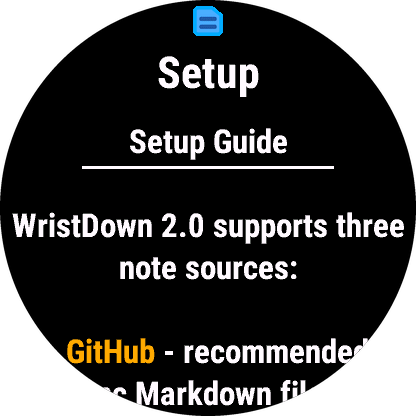
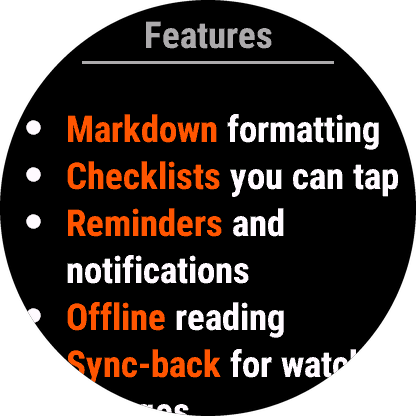
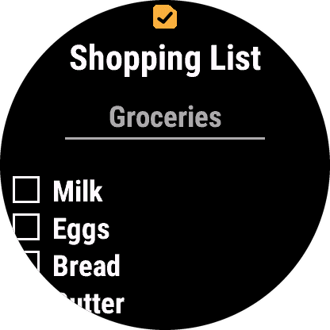
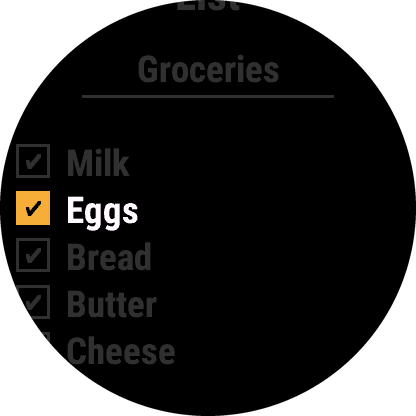
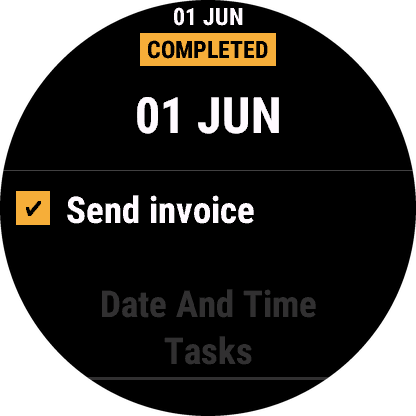
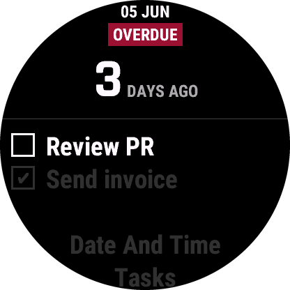
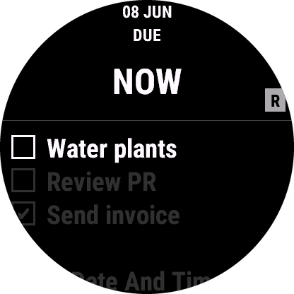
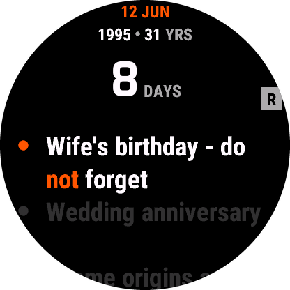

# Markdown Reference

WristDown renders Markdown notes on Garmin watches. Watches don't do rich text fonts the way a desktop app does, so formatting is shown with colors and simple watch-friendly styles. Bold and italic text is always colored, and on watches that can draw them it also uses real bold and italic letters.

> The task and event reminders described below (Obsidian Tasks subset, dates, recurrence, event tags) work only with GitHub as the sync source.

## Supported Markdown syntax

| Syntax | How it shows up |
|---|---|
| `**bold**` or `__bold__` | Yellow text, in bold letters on watches that can draw them |
| `*italic*` or `_italic_` | Light gray text, in italic letters on watches that can draw them |
| `***bold italic***` | Orange text, in bold letters on watches that can draw them |
| `# Header 1` | White text with underline |
| `## Header 2` | Light gray text with underline |
| `### Header 3` | Light gray text with underline |
| `` `code` `` | Cyan text |
| `~~strikethrough~~` | Dark gray text |
| `- [ ] item` or `* [ ] item` | Checkbox, unchecked |
| `- [x] item`, `- [X] item`, or star-list equivalents | Checkbox, checked |
| `- item` | Bullet point |
| `1. item` | Numbered list |
| `---` | Horizontal line |
| `[text](https://...)` or `<https://...>` | Blue link you can open on your phone |

How it looks on the watch:

<p>


</p>

## Checkboxes

Checkboxes are what make WristDown useful for task lists, shopping lists, and packing lists.

```markdown
# Shopping

- [x] Milk
- [ ] Eggs
- [ ] Coffee
```

On the watch:

1. Open a note.
2. Move focus to a checkbox with the buttons or touch.
3. Press select or tap to toggle it.
4. Exit the note to save.

For GitHub notes, checkbox changes can sync back to the Markdown file. Flatnotes can sync checkboxes back too, if the proxy rewrite is set up. Quick Notes checkboxes are local to the watch.

<p>


</p>

## Obsidian Tasks subset

WristDown supports a small, watch-focused subset of the [Obsidian Tasks community plugin](https://community.obsidian.md/plugins/obsidian-tasks-plugin) syntax on checkbox lines. (The [Tasks user guide](https://publish.obsidian.md/tasks/) describes the full plugin.) The main rule: a task needs a `📅` due date to become a WristDown reminder. Markers can appear in any order, and the text shown on the watch is whatever comes before the first supported marker.

Supported task line prefixes:

```markdown
- [ ] Task text 📅 2026-06-04
- [x] Done task 📅 2026-06-01 ✅ 2026-06-01
* [ ] Star-list task 📅 2026-06-04
```

Supported markers:

| Marker | Support |
|---|---|
| `📅 2026-06-04` | Required due date. This is the reminder anchor and what due/overdue is judged against. |
| `🔁 every week` | Optional recurrence. Only used when the line also has `📅`. |
| `✅ 2026-06-04` | Optional done date on checked tasks. WristDown adds or removes this on sync-back. |

Examples:

```markdown
- [ ] Water plants 🔁 every day 📅 2026-06-04
- [ ] Review PR 📅 2026-06-05
- [x] Send invoice 📅 2026-06-01 ✅ 2026-06-01
```

The metadata is stripped from the note text on the watch. Tasks with due dates show up in the reminders view and can be toggled from the note view, and for GitHub notes the changes sync back to the file.

Task reminders show due-now, completed, and overdue states:

<p>



</p>

### How this differs from the Obsidian Tasks plugin

WristDown is compatible with the useful parts of the Tasks emoji format, but it is not the Tasks plugin running on your watch.

| Area | Obsidian Tasks plugin | WristDown |
|---|---|---|
| Task source | Can query tasks across a vault. | Reads only the synced note files in your configured GitHub folder. |
| Task format | Tasks emoji format or Dataview format. | Emoji-style markers only; no Dataview fields. |
| Reminder anchor | Tracks undated tasks and several date fields. | Needs a `📅` due date to make a reminder. |
| Statuses | Richer/custom statuses when configured. | `- [ ]` is open, `- [x]`/`- [X]` is done. Anything else isn't an interactive task. |
| Queries | Tasks query blocks. | No query blocks; task lines are parsed directly. |
| Recurrence history | Completing a recurring task can leave a completed `✅` line and create a new open one. | One active recurrence line. Completing from the watch rewrites that line back to open, drops the `✅`, and advances the date. No history line is kept. |
| Advanced fields | Priorities, IDs, dependencies, created dates, on-completion behavior, and more. | Ignored for reminder behavior. Unsupported markers after a supported one may be stripped from the watch display. |

> If the completed-line history from the Tasks plugin matters to you, don't complete that recurring task from the watch, or keep the history outside the watch note. WristDown is meant for a small, current watch task list, not a full vault task database.

Not interpreted: task IDs (`🆔`), created dates (`➕`), priorities, dependencies, blocking relationships, custom checkbox statuses beyond `- [ ]`, `- [x]`, and `- [X]`, query blocks, the Dataview format, and recurrence phrases outside the grammar below. Unsupported markers stay visible if no supported marker comes before them; after a supported marker they may be hidden along with the stripped metadata, but either way they don't affect behavior.

## Dates and times

Supported date formats for task due/done dates and event dates:

| Format | Meaning |
|---|---|
| `YYYY-MM-DD` | All-day date |
| `YYYY-MM-DD HH:MM` | Date with time |
| `YYYY-MM-DD HH:MM:SS` | Date with seconds |

Examples:

```markdown
- [ ] Renew license 📅 2026-06-10
- [ ] Join call 📅 2026-06-10 14:30
```

## Recurrence

Recurrence works on Tasks lines with `🔁 ...` and on event lines with `@repeat(...)`.

Supported forms:

| Syntax | Meaning |
|---|---|
| `daily` | Every day |
| `weekly` | Every week |
| `monthly` | Every month |
| `yearly` | Every year |
| `annually` | Every year |
| `every day` or `every days` | Every day |
| `every week` or `every weeks` | Every week |
| `every month` or `every months` | Every month |
| `every year` or `every years` | Every year |
| `every N days` | Every N days, where `N` is 1 to 1000 |
| `every N weeks` | Every N weeks, where `N` is 1 to 520 |
| `every N months` | Every N months, where `N` is 1 to 120 |
| `every N years` | Every N years, where `N` is 1 to 12 |
| any of the above plus `when done` | For tasks, repeat from the completion date |

Whitespace and letter case don't matter: `Every   2   Weeks When Done` is read as `every 2 weeks when done`. The unit can be singular or plural, so `every 2 week` works too.

Example recurring tasks:

```markdown
- [ ] Water plants 🔁 every day 📅 2026-06-04
- [ ] Clean filters 🔁 every 2 weeks when done 📅 2026-06-07
- [ ] Renew license 🔁 annually 📅 2026-06-10
```

### Days of the week (tasks only)

`🔁` task rules can also name days of the week, as Obsidian Tasks writes them:

| Syntax | Meaning |
|---|---|
| `every weekday` | Monday to Friday |
| `every Monday`, `every Monday and Friday`, `every Tue, Thu` | Those days every week |
| `every week on Tuesday, Friday` | Those days every week |
| `every N weeks on Friday`, `every 2 weeks on weekdays` | Those days every N weeks, where `N` is 1 to 520 |
| any of the above plus `when done` | Next matching day after the completion date |

Days can be joined with commas, `and` or `or`, and written in full (`Monday`, `Mondays`) or shortened (`Mon`, `Tues`, `Thurs`). With `every N weeks`, weeks start on Monday and are counted from the week of the `📅` date, as in Obsidian Tasks. The `📅` date itself counts as an occurrence even if it falls on another day.

```markdown
- [ ] Standup 🔁 every weekday 📅 2026-10-02
- [ ] Gym 🔁 every Monday and Friday 📅 2026-09-28
- [ ] Review 🔁 every 2 weeks on Tuesday, Thursday 📅 2026-10-01
```

These rules work on `🔁` tasks only; on an event, `@repeat(every Monday)` is not a repeat.

With GitHub sync-back, completing a recurring task rewrites the same line back to unchecked, removes any `✅` marker, and advances the `📅` date to the next occurrence. Normally the next occurrence is calculated from the existing due date; with `when done`, from the completion date.

Not supported: monthly rules like "the first Monday" or "on the 1st", calendar-date phrases, natural-language rules outside the forms above (including text after the rule, such as a `#tag`), and Tasks recurrence features that need fields other than `📅`. A task whose `🔁` rule isn't supported is read-only on the watch: its checkbox is shown blocked and the reminder detail shows `R!`, so completing it on the watch can't end the series. Complete it in Obsidian instead. The same applies to a `🔁` task without a `📅` due date (only `⏳` or `🛫`, or no date): it has no reminder on the watch, and its checkbox is read-only.

Monthly and yearly rules keep the day of month: a monthly date on the 31st falls on the last day of shorter months and returns to the 31st afterwards, and a yearly Feb 29 falls on Feb 28 outside leap years. When the watch advances a recurring task, it always writes the date with its year.

## WristDown event tags

Events are reminders for things that aren't tasks: appointments, birthdays, renewals, anniversaries. They have no checkbox, can't be completed from the watch, and are never written back.

<p>

</p>

Event tags go on plain unordered list items. Ordered list items and checkbox lines don't count as event syntax.

```markdown
- Dentist @date(2026-06-10 09:00) @remind(1d)
* Wife's birthday - do ***not*** forget @date(1995-06-12) @repeat(yearly) @remind(7d)
```

Supported tags:

| Tag | Support |
|---|---|
| `@date(...)` | Required event date or date/time. |
| `@repeat(...)` | Optional recurrence, same grammar as tasks. |
| `@remind(...)` | Optional notification lead time. Events with `@remind(...)` can notify at both the lead time and the event date/time. |

Tags are exact lowercase with no space before the parenthesis: `@date(...)`, not `@Date(...)` or `@date (...)`.

Supported event date values:

| Format | Meaning |
|---|---|
| `YYYY-MM-DD` | All-day event |
| `YYYY-MM-DD HH:MM` | Event with time |
| `YYYY-MM-DD HH:MM:SS` | Event with seconds |

If an event has a full date with a year, WristDown keeps that original date and shows a small time-since line in the reminder detail above the countdown. The unit follows the recurrence period: yearly events show years, monthly events show months, weekly events show weeks, and daily events show days, for example `1995 · 31 YRS` or `2024 · 730 DAYS`.

Supported `@remind(...)` offsets:

| Syntax | Meaning |
|---|---|
| `@remind(7d)` | 7 days before |
| `@remind(2h)` | 2 hours before |
| `@remind(30m)` | 30 minutes before |

On a repeating event, a lead of one repeat period or more is ignored and the event notifies only at its time: for example `@remind(1d)` or longer on a daily event, `@remind(7d)` or longer on a weekly one, `@remind(28d)` or longer on a monthly one, and `@remind(365d)` or longer on a yearly one.

Events appear in the reminders view and can trigger notifications, but they're always non-interactive.

## Headers

Headers get underlines for visual hierarchy:

```markdown
# Main Header
## Section Header
### Subsection Header
```

## Text formatting

Formatting can be combined in a single line:

```markdown
This is **bold** and *italic* text with `code`.
```

Bold italic shows up orange:

```markdown
***Important***
```

## Emojis

> **Tip:** If your watch supports emoji, drop them into your notes. They render in the note view, and the first part of a note also shows up as a preview line in the main menu — so an emoji at the start of a note's first line makes it much faster to spot the note you want in a long list.

Emoji are just text, so you can use them anywhere: in titles, headers, list items, or task text. A single leading emoji per note works well as a visual category tag.

```markdown
# 🛒 Groceries

- [ ] Milk
- [ ] Coffee
```

Some handy ones for tagging notes at a glance:

| Emoji | Good for |
|---|---|
| 🛒 | Shopping / groceries |
| ✈️ | Travel / packing |
| 💼 | Work |
| 🏠 | Home / chores |
| 💊 | Health / meds |
| 🎁 | Gifts |
| 🏋️ | Workout |
| 📞 | Calls / contacts |
| 🍴 | Food / recipes |
| 💡 | Ideas |

Whether a specific emoji shows depends on your watch's font support — older or smaller-screen devices may render some as a blank box or skip them. If an emoji doesn't appear, pick another or use plain text. Note that `📅`, `🔁`, and `✅` have special meaning on checkbox task lines (see the Obsidian Tasks subset above), so keep those for tasks rather than as decoration.

## Lists

Both unordered and ordered lists work:

```markdown
- First item
- Second item
- Third item

1. First step
2. Second step
3. Third step
```

List items can contain checkboxes:

```markdown
- [ ] Unchecked task
- [x] Completed task
```

## Horizontal rules

Three or more dashes make a separator:

```markdown
First section

---

Second section
```

## Links

Web links show up in blue:

```markdown
Read the [setup guide](https://github.com/mrgitter/wristdown) first.
Or paste it as <https://github.com/mrgitter/wristdown>.
```

Scroll to a link as you would to a checkbox: it moves to the middle of the screen and gets an underline. Press START (or tap it on a touch watch), confirm, and Garmin Connect shows a notification on your phone that opens the page. The phone has to be connected over Bluetooth; otherwise the watch says so and nothing is sent.

- Only `http://` and `https://` links can be opened. Other links (`obsidian://`, `mailto:`, links to other notes) show their text only.
- Bare URLs without `<...>` or `[text](...)` stay plain text.
- A note can have up to 32 links, each up to 512 characters; beyond that the text shows without a link.

## Unsupported syntax

These aren't rendered as rich content:

- Images `` - only the alt text is shown
- Block quotes `> quote` - shown as plain text
- Fenced code blocks - shown as plain text
- Tables - shown as plain text
- Nested lists - flattened to a single level

## Tips for watch-friendly notes

1. Keep notes short.
2. Use task lines for things you actually want to act on from the watch.
3. Give watch notes their own GitHub folder.
4. Keep that folder to about 10 notes, 15 at most.
5. Keep each note under 15,000 characters (10,000 on Forerunner 255/255S) to see all of it on the watch; a longer note shows its first part and is read-only. Files of 30 KB or more are skipped.
